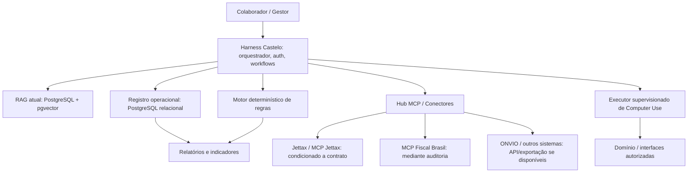
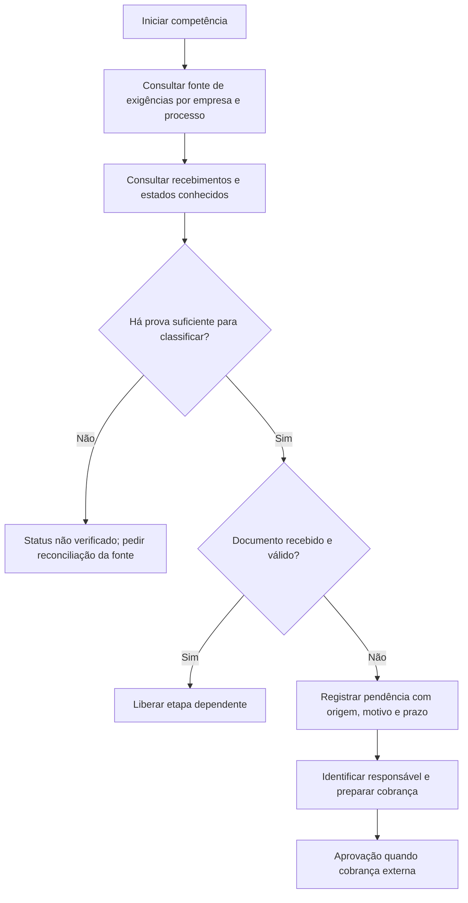
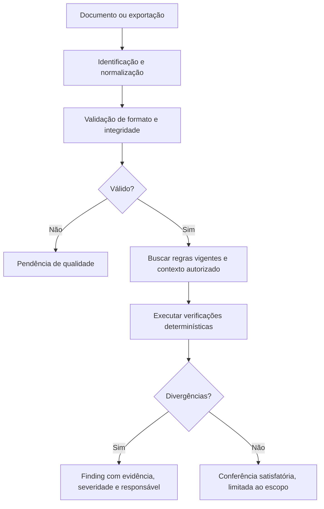
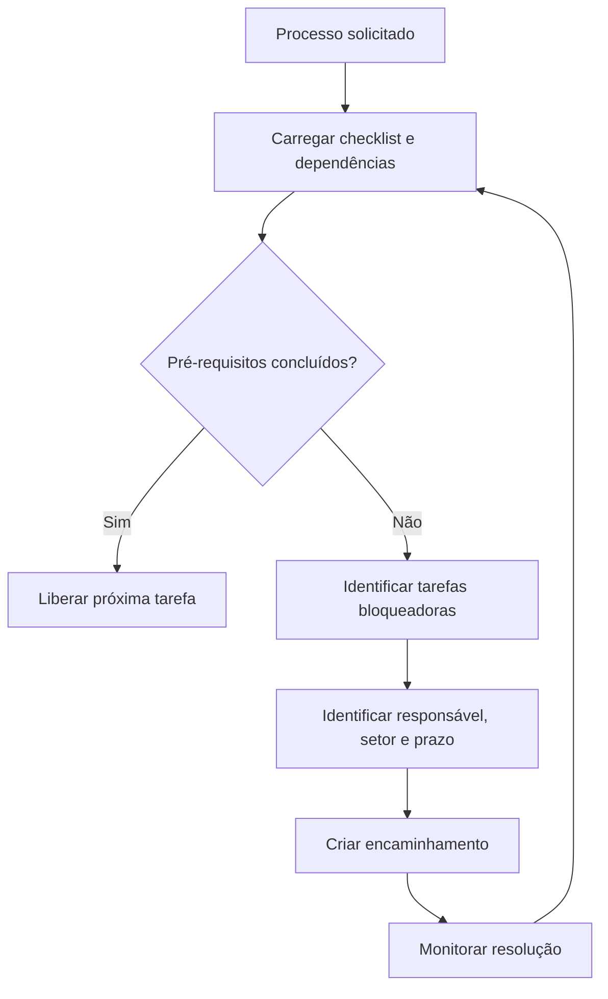
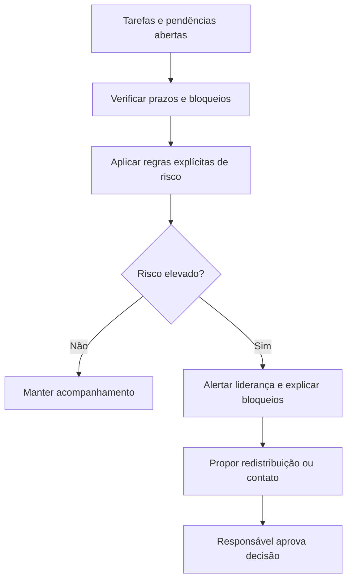
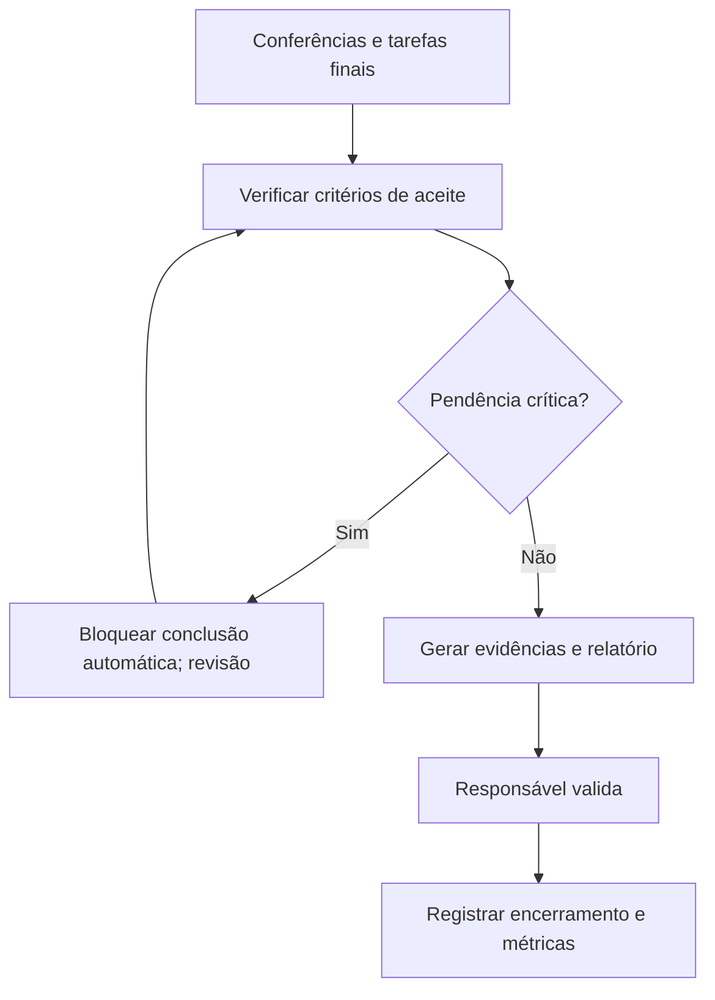

# Infraestrutura Operacional Agêntica Castelo Branco
**Proposta técnica — 28/10/2026**

## 1. Premissas
- Já existe um Harness Castelo, com motor RAG e PostgreSQL + pgvector funcional.
- O escritório utiliza Domínio, ONVIO e Jettax, mas a disponibilidade de integrações e recursos contratados deve ser confirmada.
- Já pode existir um responsável e uma fonte para controle de documentos faltantes. O projeto deve integrar, não duplicar, essa fonte.
- Não presumir que ausência de resultado em conector equivale a documento ausente.
- Processamentos fiscais, alterações cadastrais, transmissões e confirmações críticas exigem validação humana.

## 2. Objetivo
Criar um ambiente de inteligência operacional transversal para Fiscal, Contábil, Pessoal, Atendimento, Financeiro, RH, TI e Gestão: centralização lógica de dados e conhecimento, detecção de pendências, compreensão de dependências entre setores, conferência estruturada e geração de indicadores mensais.

## 3. Arquitetura-alvo

O MCP é uma interface para obter capacidades; não substitui armazenamento operacional, orquestração nem autoridade normativa. Primeiro usar integração oficial/exportação, depois automação visual quando indispensável.

## 4. Fluxogramas iniciais

### 4.1 Checagem de documentos esperados

### 4.2 Conferência documental

### 4.3 Dependências interdepartamentais

### 4.4 Monitoramento de prazo

### 4.5 Encerramento de competência

## 5. MVP: Central Inteligente de Pendências e Conferências
**Caso de uso inicial:** Uma competência, uma carteira piloto de empresas e uma rotina do Fiscal. O usuário consulta pendências, responsáveis e riscos; o sistema compara documentos esperados versus recebidos e executa uma conferência simples em XML/exportação.

**Dentro do escopo:**
1. Adaptar a autenticação e os perfis existentes do Harness para escopos de empresa e departamento.
2. Modelar empresa, competência, tipo documental, documento, tarefa, dependência, responsável, evento, evidência e finding.
3. Implementar 1 conector inicial: API/MCP/exportação de pendências que já exista; manter importação CSV como contingência.
4. Sincronização incremental, idempotência e registro de origem, horário e qualidade da informação.
5. Regras determinísticas para detectar exigido/recebido/inválido/não verificado.
6. Conferência inicial de XML NF-e e, se exportável, conciliação simples com relatório do Domínio.
7. Ferramentas de leitura no Harness e respostas com links internos para evidências.
8. Painel de status por empresa, competência, responsável e setor.
9. Auditoria e revisão humana.

**Fora do escopo:** apuração e transmissão automáticas, escrita no Domínio, cobranças externas automáticas, criação de um ERP próprio, operação multiagente autônoma irrestrita.

**Marcos e aceite:**
- M0 — Mapear rotina real e fonte autoritativa: ao menos um checklist validado e identificada origem das pendências.
- M1 — Persistência e identidade: dados com empresa, competência, source_id, timestamp, owner e estados coerentes.
- M2 — Conector: sincronização repetível sem duplicatas; falhas visíveis; acesso somente a empresas autorizadas.
- M3 — Dependências: sistema mostra causa de bloqueio e responsável em casos homologados.
- M4 — Conferência: execução reproduzível em arquivos de teste com evidências por regra.
- M5 — Chat: três intents verificadas (o que falta, o que está bloqueado, o que precisa de revisão).
- M6 — Piloto: responsáveis validam classificação e métricas de falsos positivos.

## 6. Modelo de dados mínimo
- `companies(id, tax_id, name, active)`;
- `departments(id, name)`;
- `users(id, department_id, role)`; `user_company_access(user_id, company_id, scope)`;
- `periods(id, company_id, reference_month, workflow_type, status)`;
- `document_requirements(id, workflow_type, doc_type, applicability_rule, valid_from, valid_to)`;
- `documents(id, company_id, period_id, doc_type, source, external_id, checksum, received_at, validation_status, access_class)`;
- `tasks(id, company_id, period_id, department_id, assigned_to, due_at, status, source, external_id)`;
- `dependencies(id, predecessor_task_id, successor_task_id, dependency_type)`;
- `findings(id, company_id, period_id, rule_id, severity, status, reviewer_id)`;
- `evidence(id, finding_id, document_id, reference_uri, source_timestamp)`;
- `sync_runs(id, connector, started_at, finished_at, status, error)`;
- `audit_events(id, actor, action, object_id, timestamp, approved_by)`.

Separar o conteúdo de documentos no repositório documental seguro; armazenar no PostgreSQL preferencialmente metadados, hashes e referências. Adotar política de retenção, LGPD e escopo por empresa. Não indexar automaticamente dados pessoais da folha em base acessível ao restante do escritório.

## 7. Ferramentas iniciais expostas ao Harness
- `list_missing_documents(company_id, period_id)`
- `get_process_status(company_id, period_id, process_type)`
- `list_blockers(department_id?, period_id?)`
- `get_task_dependencies(task_id)`
- `get_document_evidence(document_id)`
- `run_document_checks(document_id, check_profile)` (somente leitura)
- `list_findings(company_id, period_id, severity?)`
- `prepare_followup(task_id)` (rascunho; sem envio)
- `get_operational_summary(period_id, department_id?)`
Todas com validação de identidade no servidor, RBAC/ABAC e filtros aplicados antes da consulta. O LLM não define sozinho o escopo de autorização.

## 8. Plano de produto completo

### 8.1 Módulos
1. Conhecimento Corporativo: RAG de políticas, procedimentos, normas, manuais, documentação interna, owner e validade.
2. Operação e Pendências: tarefas, documentos, checklist, SLAs internos e dependências.
3. Conferência e Auditoria: fiscais, contábeis, trabalhistas e administrativas, com regras e evidências.
4. Integrações e Automação: conectores MCP/API/CSV, eventos e Computer Use supervisionado.
5. Inteligência Gerencial: relatórios de causas de atraso, gargalos, previsões quando houver histórico, qualidade e retrabalho.
6. Governança: perfis, identidade, segregação de clientes, logs, revisão, política de IA, treinamento.

### 8.2 Expansão por setor
- Fiscal: documentos faltantes, XML, CFOP/CST, divergência com escrituração, reconciliação de apuração.
- Contábil: extratos, conciliações, lançamentos inconsistentes, fechamento, balancete.
- Pessoal: documentos admissionais, eventos da folha, férias, rescisões, bloqueios para fechamento (com controles reforçados de privacidade).
- Atendimento: solicitações e lembretes autorizados, acompanhamento de clientes.
- Financeiro: contas a pagar/receber, comprovantes, vencimentos e conciliações.
- RH: trilhas de treinamento e procedimentos com dados agregados e permissões estritas.
- TI: integrações falhas, inventário, disponibilidade e solicitações técnicas.
- Gestão: carteira, capacidade, gargalos interdepartamentais, tendências e gestão de qualidade.

### 8.3 Roadmap evolutivo
- Ciclo 1: fonte de pendências + modelo de estados + consulta no Harness.
- Ciclo 2: auditor documental focalizado + matriz de dependências entre Fiscal, Contábil e Pessoal.
- Ciclo 3: painel interdepartamental, alertas e triagem; revisão humana e regras de escalonamento.
- Ciclo 4: mais fontes oficiais, conectores MCP, automações de leitura e coleta; Computer Use somente onde necessário.
- Ciclo 5: análise longitudinal de gargalos e capacidade, expansão para financeiro, atendimento, RH e TI.

### 8.4 Indicadores
Cobertura documental; % de competências prontas para conferência; tempo em bloqueio; aging de pendências; percentual de tarefas concluídas no prazo; tempo para resolver divergências; falsos positivos; qualidade de fontes; volume de retrabalho; tempo economizado validado; gargalos por processo e não por perfil pessoal isolado.

## 9. Segurança e governança
- Perfis e acesso por cliente, setor, função e finalidade; segregação de informação trabalhista, bancária e fiscal.
- Segredos de integrações em cofre; nunca em prompts ou logs; contratos e termos de uso verificados.
- Proibir escrita automática em sistemas fiscais no MVP.
- Publicação de cobranças externas, alteração de lançamentos, apuração e transmissão somente após autorização explícita e verificação.
- Logs contendo ação, fonte, período, versão da regra, resultado e aprovador; minimizar dados pessoais.
- Evidências imutáveis para auditoria; cópias e retenção conforme política aprovada.
- Alertas devem diferenciar certeza, suspeita e falta de dados. Sem dados atualizados não atribuir status concluído ou ausente.
- Testar controles de prompt injection em documentos e saídas de conectores.

## 10. Checklist de compatibilidade com Harness atual
- [ ] Identidade/autorização por usuário, departamento e carteira de empresas
- [ ] Ferramentas MCP com namespace e allowlist
- [ ] PostgreSQL relacional disponível além do pgvector
- [ ] Versionamento de documentos e fontes do RAG
- [ ] Jobs assíncronos, fila de tarefas e controle de falhas
- [ ] Storage de arquivos com segurança e checksum
- [ ] Auditoria de ferramentas, ações e aprovações
- [ ] Scheduler para sincronizar estados e monitorar prazos
- [ ] Interfaces de consulta/painel e exportação de relatório
- [ ] Sandbox para testar conectores com dados fictícios
- [ ] Garantias de idempotência e detecção de duplicidade
- [ ] Ambiente Windows controlado, somente se Computer Use for necessário

## 11. Decisões pendentes para descoberta operacional
1. Onde a empresa controla as pendências documentais hoje? Qual é a fonte autoritativa?
2. Quais módulos do ONVIO/Jettax estão contratados? MCP Jettax habilitado? Há API/exportação?
3. Quem é dono do checklist e quem autoriza cobrança ao cliente?
4. Quais dependências entre setores são formalmente reconhecidas?
5. Quais relatórios o Domínio exporta por empresa e competência?
6. Quem valida fiscalmente os findings? Qual é o protocolo de contestação/correção?

## 12. Fontes externas para conferência técnica
- Jettax MCP, documentação: https://jettax360-help.freshdesk.com/support/solutions/articles/151000237571--como-utilizar-o-assistente-de-ia-jettax-mcp-
- Jettax e Domínio: https://www.jettax.com.br/blog/jettax-e-dominio-agora-estao-integrados-veja-o-que-muda-no-seu-escritorio/
- Thomson Reuters Portal do Cliente: https://www.dominiosistemas.com.br/solucoes/evolucao-em-nuvem/portal-do-cliente/
- MCP Fiscal Brasil: https://github.com/DeHor-Labs/mcp-fiscal-brasil

**Regra de produto:** o Harness oferece contexto, coordenação e evidências; os sistemas de origem continuam autoridades para seus registros, e os responsáveis técnicos continuam aprovando ações críticas.
